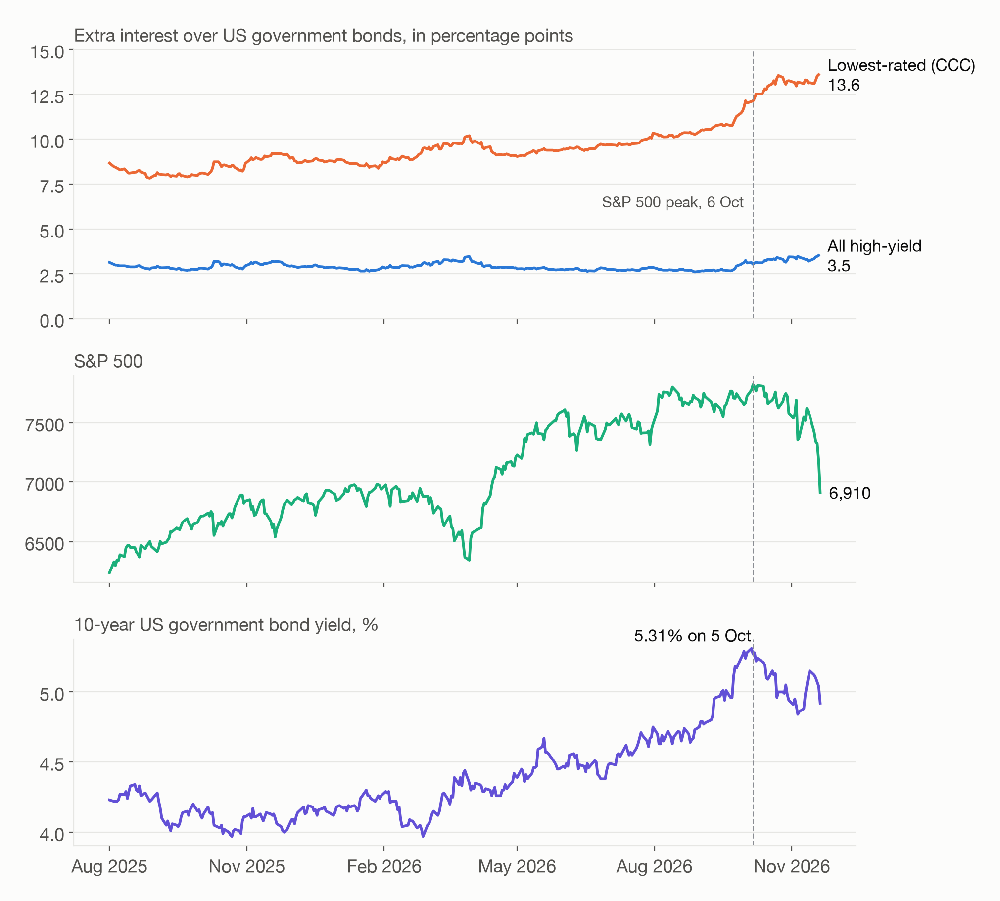
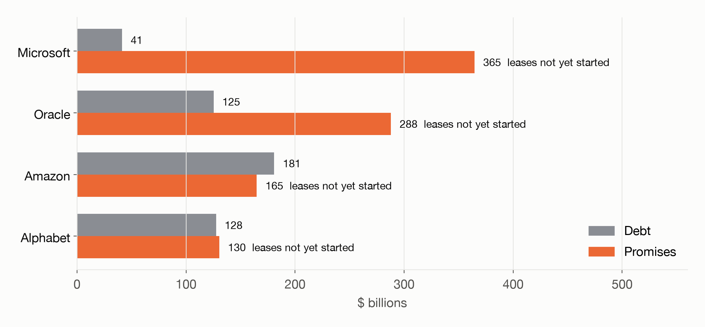
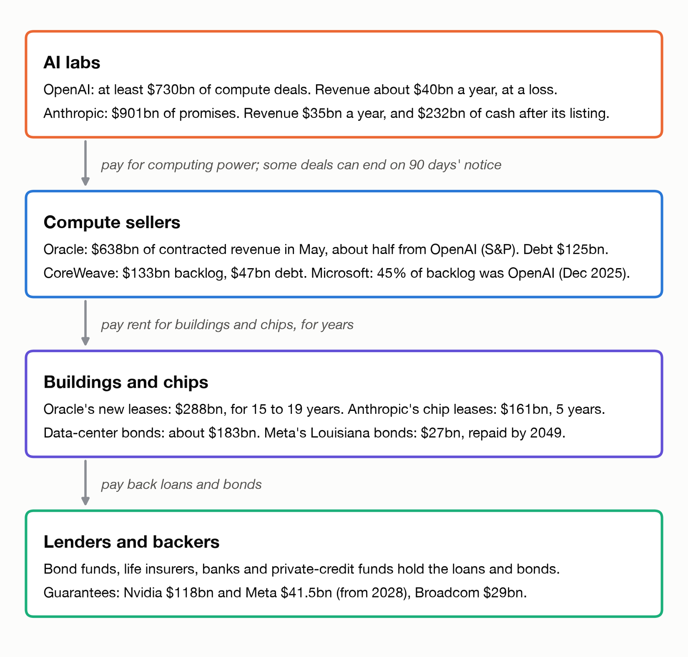

On 11 November, the VIX sat at 17.5. The VIX measures how much traders expect US stocks to swing, and 17.5 is calm. Seven trading days later, on Friday 20 November, it was 35.9. In between, the S&P 500, the index of 500 large US companies, fell 9.3%. Nvidia, one of the biggest companies in it, lost 23% in one week.

Only 0.5% of all seven-day stretches since 1975 were that bad for the S&P 500.

I think recessions come from the debt cycle. People borrow against something, that something loses value, and the loans start to hurt. So when stocks fall this fast, I want to know which debt depends on the prices that are falling. I spent the past few days with AI models, going through Federal Reserve data, company reports and 50 years of market history.

The debt I expected to find wasn't where I looked. The part of this boom that worries me most is a set of promises, and no debt total includes them.

## Fast, but not deep

The S&P 500 is 11.6% below its high of 6 October. That sounds bad, but it isn't rare. The index has been at least that far below its record high on 30% of all trading days since 1975. The speed is the rare part.

The fall also started long before November: a basket of 11 AI-linked shares peaked on 1 June and is now 30.5% lower. CoreWeave and Nebius rent out AI computing power, and both are down about 71% from their highs of the past 12 months.

## The weakest debt turned first

When I lined up the dates, the weakest borrowers were in trouble while stocks were still rising.

_Top: the extra interest that company bonds pay over US government bonds, in percentage points. Orange: companies with the lowest credit rating (CCC). Blue: all companies with low ratings, called high-yield. Middle: the S&P 500. Bottom: the 10-year US government bond yield. The dashed line is the S&P 500's peak on 6 October._

Look at the orange line. It shows how much extra interest lenders charge the companies with the lowest credit ratings. On 28 August 2025 it was 7.8 percentage points. On the day the S&P 500 peaked, it was 12.1 points. So while stocks rose to a record, borrowing got much more expensive for the weakest companies.

The blue line is the average for all low-rated companies. On 28 August 2026 it was 2.6 points, the lowest in a year. The average looked fine while the weakest borrowers paid more and more.

The bottom line shows the price of money in general. The 10-year US government bond yield rose from about 4% to 5.31% on 5 October. The S&P 500 peaked the next day.

Matching dates can be chance, and timing doesn't prove cause. But for my question, the order matters: the weakest debt got worse first, and stocks fell later.

## How a falling price reaches a loan

A falling price hurts a loan only through a link, in the contract or in the borrower's finances.

The fastest link is a margin call. Say you own $100,000 of shares and borrowed $50,000 from your broker to buy them. The rules let your broker act when your own stake falls below 25% of the shares' value. That happens if the shares fall 33%. Then the broker asks for more cash, and if you can't pay, it sells your shares. If you had borrowed $70,000, a 7% fall would be enough.

The slowest link isn't in any contract. No mortgage lender can call your loan because stocks fell. The effect runs through lower wealth, then less spending, then jobs.

The US debt with some link to an asset price that I could find adds up to $12.0tn to $13.6tn. That is a rough sum: some pieces overlap, and the higher figure includes some debt from outside the US. The biggest part is loans on commercial and apartment buildings: $5.1tn by the Mortgage Bankers Association's count. The Federal Reserve's wider measure, which adds construction loans and loans on buildings the owner uses, is about $6.5tn. My study split this debt into 46 pieces. For each piece, I wanted one number: how far prices must fall before the lender can act. I found it for only 2 pieces: Meta's bonds and the bonds of Strategy, a company that holds bitcoin. Neither has a price trigger. For the other 44, I found no public source for it. Brokers and private lenders don't publish full data on how close their borrowers are to a trigger.

## What could break

So I looked for strain that is already visible.

| Where | What I see |
|---|---|
| Smaller compute sellers, such as CoreWeave | At recent spending, their cash runs short within months. In early November, some CoreWeave bonds sold for about 80% of their face value. |
| Private-credit funds sold to individuals | 5 of the 6 largest paid only part of what investors asked to withdraw, in August and September. |
| Companies with the lowest credit rating | They pay 13.6 percentage points more than the US government, the most in three years of data. |
| Office buildings | 12.3% of office loans in commercial mortgage bonds are behind on payments. |

The private-credit funds are the only place where I saw a trigger act. In August, investors asked Blackstone's largest fund of this kind to buy back 181 million shares. It bought back 49.9% of them. These funds usually offer to take back up to 5% of their shares each quarter, so the other investors have to wait.

Outside these weak spots, debt markets are calm. The average low-rated company pays 3.5 points of extra interest, less than at the April 2025 peak. I found no case since early October where lenders forced the sale of $5bn or more in the US. And in 7 big US stock falls since 1987, I found a strong link from falling collateral to wide credit losses only once, in 2007 to 2009.

One detail worries me more. The 2-year US government bond yield shows where traders expect the Federal Reserve's rate to be over the next two years. The overnight rate shows where it is now. In most sharp falls since 2018, traders expected a cut, so the 2-year yield dropped below the overnight rate. Today it is 4.63%, against an overnight rate of 3.91%, so traders don't expect a cut soon. Only one similar sell-off since 2018 had a larger gap: early 2022, the start of a fall that reached 25%.

## The debt that isn't called debt

Take Oracle. It has agreed to rent data centers that are still being built. When each building is ready, Oracle must pay rent for 15 to 19 years, whether it has customers for the building or not. That's $288bn of rent in total, or about $15bn to $19bn a year on average. Accounting rules count a lease as a liability only once it starts. Until then, it appears only in a note in the company's report.

So in practice, it works like debt: a fixed payment that Oracle can't skip. It just isn't counted yet.

_Debt against leases that are signed but have not started yet, in billions of dollars, from each company's latest report._

Microsoft, Oracle, Amazon and Alphabet together have $948bn of these leases. That's twice their combined debt of $475bn, and most of the gap comes from two companies. Microsoft's leases are about 9 times its debt, and Oracle's more than twice. Amazon's and Alphabet's leases are about the size of their debt.

For scale, $948bn is about two-thirds of all the money US investors owe their brokers ($1.45tn). If the leases run 15 to 20 years on average, that's roughly $47bn to $63bn of rent a year. That's my rough math, because the companies don't all publish their lease lengths.

The leases are only one layer. Above them sit the AI labs, which promise to buy computing power. Anthropic has promised about $901bn. OpenAI has announced or been reported to sign compute deals worth at least $730bn with Microsoft, Oracle, Amazon, CoreWeave and Cerebras, another seller of computing power. That OpenAI figure adds up deals announced at different times, some as upper limits, so it isn't an exact total.

_The chain of promises, from the AI labs at the top to the lenders at the bottom. Amounts from company reports, Anthropic's prospectus, S&P Global Ratings, the Wall Street Journal and Barclays. Don't add the layers together: much of it is the same money passing down._

The money moves down the chain. A lab pays a compute seller, such as Oracle, CoreWeave or Microsoft. The compute seller pays rent for buildings and chips. The building owners pay back the loans and bonds they used to build. Data-center bonds alone are about $183bn, by Barclays' count.

## The two biggest labs

The top of the chain is mixed.

Anthropic looks strong for now. In the last 12 months, its revenue was about $35bn. In the first nine months of 2026, its operations brought in $6.6bn more cash than they used. After its stock listing in November, its prospectus shows about $232bn of cash and short-term investments. That's 3.3 times the $70.7bn of promises due in the 12 months after September.

OpenAI is the weaker payer. In its last quarter, its revenue was $10.0bn and its adjusted operating loss was $10.9bn, or about $13.5bn when you count the shares it pays its staff with, according to the Wall Street Journal. It pays for its building largely with investors' money, and it raised a $122bn round in March. So OpenAI can keep its promises as long as investors keep putting money in. Investors put money in more easily when AI shares rise than when they are 30% down.

That's the hidden price link. AI share prices affect how easily the labs raise money. That decides whether they keep their promises, and that decides whether the leases and the data-center bonds get paid. My study listed these promises but left them out of its debt totals, because they aren't debt.

## What happens if a promise breaks

Some lab contracts can end on 90 days' notice. Leases like Oracle's run 15 to 19 years.

Anthropic's deals with SpaceXAI cost about $3.1bn a month at full use. After the first periods end in January and March 2027, Anthropic can leave with 90 days' notice. Lambda, another compute seller, missed a lease deadline, so either side can now end its $34.9bn deal with Anthropic. At CoreWeave, $1.9bn of customers' prepaid money was moved into money owed back to customers last quarter, because some contracts became cancellable.

The buildings stay. The $27bn of bonds that finance Meta's data center in Louisiana get repaid by 2049.

Oracle shows the problem. S&P Global Ratings estimated that roughly half of Oracle's contracted future revenue in May came from OpenAI. At the end of August, Oracle owed $125bn and had $37bn of cash and short-term investments. OpenAI's deal with Oracle reportedly runs for about five years, and then OpenAI can renew or leave. I couldn't find whether it can leave earlier. But if OpenAI paid less, Oracle's revenue would fall, while its rent and its debt payments stay the same. In its last quarter, almost half of Oracle's cash from operations, $11.4bn of $23.1bn, was customers paying in advance. That money keeps coming only while customers have cash to pay ahead.

If a promise breaks, the loss moves down the chain:

1. The compute sellers lose revenue first. Oracle and CoreWeave carry much more debt for their size than Microsoft or Amazon.
2. If a compute seller can't pay its rent, the building owners lose income.
3. The building owners' lenders lose next: bond funds, life insurers, banks and private-credit funds.
4. The guarantors pay last. Nvidia guarantees up to $105bn of payments on one OpenAI-related data-center project, if a partner defaults after a building is ready. Meta guarantees up to $41.5bn of the value of two data-center projects that it rents. Most of this starts only in 2028 or later.

Nobody can put an exact number on the loss. It depends on whether someone else rents the chips, which contracts let a lab leave, and what a half-empty data center is worth. If CoreWeave ends its contract because OpenAI breaks it, money from selling or moving the servers to a new customer reduces what OpenAI still owes. That helps, as long as someone else wants the servers.

This brings me back to the debt cycle. In this boom, much of the borrowing sits in contracts instead of loans, so the usual debt charts miss it. If it goes wrong, the losses still end up with the usual lenders: bond funds, insurers and banks.

## We have seen something like this before

The closest match I found is the telecom bust of 2000 to 2002, not 2008.

Back then, telecom companies borrowed to lay fiber cable before the demand existed. In 2000 they spent 36% of their revenue on building their networks, twice the share of 1996. Equipment makers lent money to their own customers so they could keep buying. Lucent alone had promised $8.1bn of such loans by September 2000. McKinsey estimated the total for nine suppliers at $25.6bn.

Then the demand grew far more slowly than planned. A Merrill Lynch analyst said only 2.7% of the fiber capacity that was switched on was in use. Telecom companies around the world defaulted on $116bn of debt in 2002 alone.

Today has the same pattern: companies build ahead of demand, and suppliers support their customers. The scale is bigger. Nvidia's guarantees, up to $118bn in total, are more than 4 times what those nine suppliers lent in 2000. Prices have roughly doubled since then, so it's still more than twice as much after inflation.

There are real differences. Microsoft, Amazon and Alphabet are far richer than the telecom start-ups were. And AI demand is real: Anthropic's revenue in the first nine months of 2026 was 13 times its revenue in the same months of 2025. What matters is whether revenue grows fast enough to pay rent that is fixed for 15 years.

I went looking for the debt that breaks. I found calm debt markets and a few weak spots. I also found about $1tn of leases and, above them, more than $1.6tn of lab promises that no debt total includes. So far, most of those promises are being kept. If AI shares keep falling, I think the promises are where the strain will show first.

The numbers come from public sources: company reports, Anthropic's prospectus, the Federal Reserve, FINRA (the brokers' self-regulator) and Cboe. The telecom history comes from reports of that time. I used AI models from OpenAI, Google and Anthropic to gather and check the data, and all three appear in this post (Google through its parent, Alphabet). Two models, one from OpenAI and one from Google, checked every fact in this post against its source.
